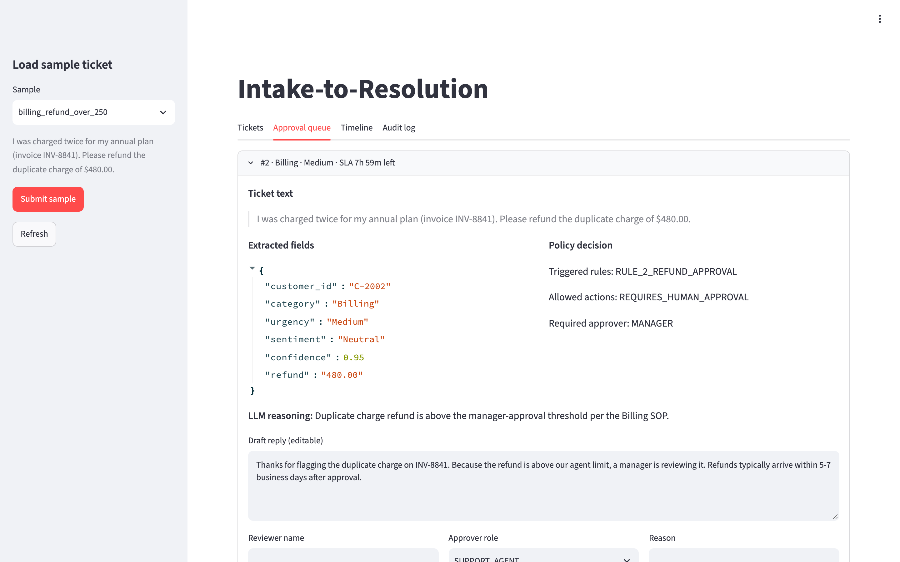
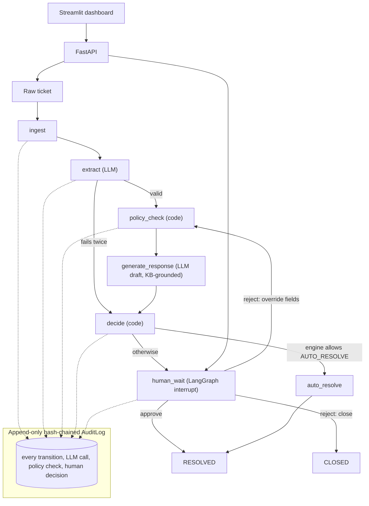
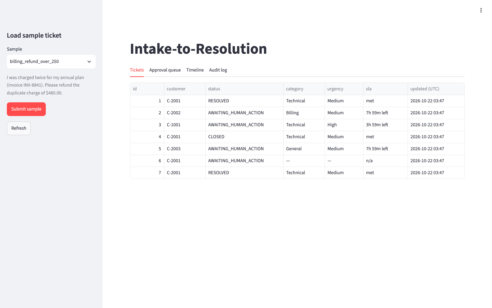
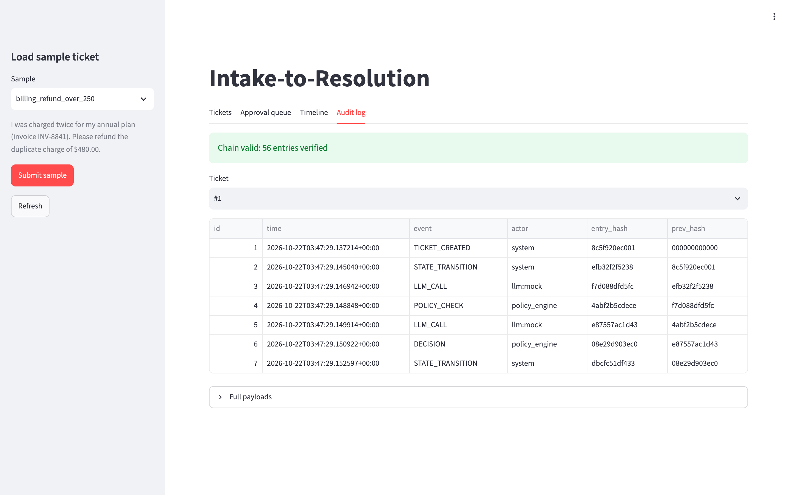

# Intake-to-Resolution Agentic Workflow & Audit Platform

Support/IT tickets come in as raw text. An LLM turns them into structured fields, a deterministic policy engine decides what is allowed, and the ticket is either auto-resolved or paused for a human. Every step lands in a tamper-evident audit log.

**Why:** in a regulated or high-stakes support flow you want the LLM's flexibility for reading messy text, but not its judgment on money, SLAs or escalation. This project keeps the two strictly separate and makes every decision reconstructable after the fact.

It runs end to end with **zero API calls** in mock mode (the default), so you can demo and test it offline.



## Architecture



Components: `engine/` (schemas, LLM providers, policy engine, LangGraph workflow), `database/` (SQLModel + audit log), `main.py` (FastAPI), `app.py` (Streamlit, talks to the API only).

## What the AI does vs. what code does

| LLM (probabilistic) | Code (deterministic) |
|---|---|
| Extract category, urgency, sentiment, entities, confidence | VIP lookup by `customer_id` (never from LLM output) |
| Draft the customer reply from the KB excerpt | Legal-keyword scan of the raw text |
| Propose an `action_type` | Rules 1-3, confidence and refund thresholds (`Decimal`) |
| | SLA deadline math, approver privilege checks |
| | Final routing: if the LLM proposes `AUTO_RESOLVE` and the engine disallows it, the engine wins and the override is audited |

All LLM output is validated against strict Pydantic schemas. Bad output is retried once with the validation error fed back; if it still fails the ticket goes to `REQUIRES_HUMAN_APPROVAL`. An error never auto-resolves.

## Setup

Requires Python 3.11+.

```bash
python -m venv .venv
.venv/bin/pip install -r requirements.txt
.venv/bin/pytest -q                                   # optional: 159 tests, no network
.venv/bin/uvicorn main:app --port 8000                # terminal 1: API
.venv/bin/streamlit run app.py                        # terminal 2: dashboard (set API_URL if not localhost:8000)
```

Mock mode needs no configuration. To use a real model, copy `.env.example` to `.env` and set:

| `LLM_PROVIDER` | Also set |
|---|---|
| `mock` (default) | nothing |
| `anthropic` | `LLM_MODEL`, `ANTHROPIC_API_KEY` |
| `openai` | `LLM_MODEL`, `OPENAI_API_KEY` |
| `ollama` | `LLM_MODEL`, optionally `OLLAMA_BASE_URL` |

The model name always comes from `LLM_MODEL`; the app refuses to start a real provider without it. Real providers are unit-tested with fake clients only; they have not been exercised against live APIs in this repo.

## 5-minute demo (mock mode)

Open the dashboard, then use the sidebar **Load sample ticket** picker. Submit each sample and watch the **Tickets** tab.

1. **`known_resolution_technical`** (standard customer, Technical, confidence 0.96, known code). Rule 3 fires; the ticket auto-resolves. Open **Timeline** to see every step.
2. **`billing_refund_over_250`** ($480 refund). Rule 2: lands in **Approval queue**, manager required. Try approving as `SUPPORT_AGENT`: you get a 403 shown in the UI. Switch role to `MANAGER`, add a reviewer name and reason, approve.
3. **`vip_frustrated_technical`** (VIP customer, frustrated). Rule 1 beats Rule 3 even though a known fix exists: escalated to a manager.
4. **`legal_terms`** (mentions "attorney", "legal action"). The legal trigger forces human review although the LLM draft proposed `AUTO_RESOLVE`.
5. **`low_confidence_vague`** (confidence 0.41). Low confidence pauses it. Reject with **override** (e.g. category Technical, urgency High); the engine re-evaluates the new fields, it cannot be forced through.
6. **`malformed_output`**. The LLM output fails validation twice; the ticket fails safe to the queue with a warning, and approving it requires you to write the reply.
7. **`retry_recovers`**. The first output is malformed, the retry succeeds; check the two `LLM_CALL` rows in the timeline.
8. Open **Audit log**: the badge shows the hash chain is valid. To see tamper detection, edit any row of `data/app.db` with raw SQL (e.g. `sqlite3 data/app.db "update auditlog set actor='x' where id=3"`) and refresh: the badge turns red and names the first bad entry.

| Tickets overview with SLA countdown | Hash-chain verification |
|---|---|
|  |  |

Same flow via API: `POST /tickets`, `GET /queue`, `POST /tickets/{id}/approve`, `GET /audit/verify` (interactive docs at `/docs`).

## Tests

```bash
.venv/bin/pytest -q
```

Covers the policy engine boundaries ($250.00 vs $250.01, confidence at threshold), the audit chain (including a test that tampering is detected), the workflow pause/resume, every API endpoint and error code, the dashboard (Streamlit `AppTest` against the in-process API), and the provider adapters. Tests never call a real LLM.

## Where to change thresholds and rules

Business rules live in config, not Python:

| File | Controls |
|---|---|
| `data/policy_rules.json` | confidence threshold, refund approval threshold, SLA hours per urgency, legal keywords, VIP escalation urgencies/sentiments |
| `data/customers.json` | which customers are VIP |
| `data/known_resolutions.json` | resolution codes eligible for auto-resolve |
| `data/policy_kb.md` | the knowledge base the draft is grounded on (`## <Category>` sections) |
| `data/fixtures/*.json` | mock LLM responses, keyed by exact ticket text |

Rule precedence (Rule 1 over Rule 2 over Rule 3) is in `engine/policy_engine.py`.

## Further reading

`DECISIONS.md` records the design choices, known limitations and future work.

## License

MIT. See `LICENSE`.
